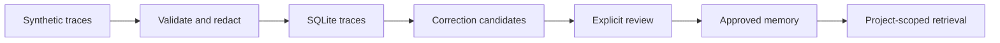

# Agent Recall Lab

Can a coding agent avoid repeating a mistake when a previous session's lesson is
retrieved **before** it runs a command?

A small, local-first memory service and evaluation lab inspired by
[Agent Beacon](https://github.com/Asymptote-Labs/agent-beacon). Original implementation;
not affiliated with Asymptote Labs. Python 3.11+, SQLite, reproducible synthetic data.

## What works today

- Schema-validated canonical traces, atomic batch import, lightweight credential redaction,
  and duplicate detection.
- Explicitly synthetic [Claude/Codex format subsets](examples/native/README.md) with
  source hashes, matched tool results, and strict rejection of unsupported records.
- SQLite storage of traces, evidence-linked candidates, and explicitly reviewed memories.
- An [evidence-linked extraction interface](docs/extraction.md), deterministic provider,
  durable provider/source metadata, and project-scoped source inspection; **not LLM extraction**.
- Project-scoped keyword retrieval of approved memory only.
- Review-gated revisions with atomic supersession and inspectable applicability context.
- Project-bound [stdio MCP recall and source tools](experiments/results/mcp-smoke.md),
  tested with real local protocol calls.
- Eight synthetic traces, separate evaluation queries, tests, and a retrieval baseline.

Full native-session ingestion, a pre-command recall loop, and execution experiments
are not implemented yet.

## Run

```bash
uv sync --locked --extra dev
uv run recall ingest examples/traces/*.json
uv run recall distill
uv run recall list
# Inspect a candidate and its source events before approving its displayed ID:
uv run recall show <candidate-id> --project storefront
uv run recall review <candidate-id> approved
uv run recall search --project storefront 'integration tests generated client'
uv run pytest -q
uv run python experiments/retrieval_baseline.py
```

`recall ingest` validates every input and imports the whole batch atomically. An invalid
file or conflicting trace ID rolls back new rows; identical redacted traces are skipped.
Direct store ingestion applies the same validation and redaction. See the
[canonical schema](src/recall_lab/schemas/trace.schema.json) and
[reproducible import checks](experiments/results/ingestion-contract.md).

Every trace is invented. Fixture commands are evidence text and never executed.
The redactor is a small baseline, not a comprehensive secret detector.

## Architecture



## Experiments and limits

[Review quality checks](experiments/results/review-quality.md) demonstrate replacement
review gating, stale-lesson retirement, and explicit poison rejection. Applicability
is descriptive context, not an enforced command policy.

[Extraction checks](experiments/results/extraction-contract.md) retain the unsafe
correction that passes the ordering rule and verify provider failure rollback.

[Adapter boundary checks](experiments/results/native-adapters.md) reproduce synthetic
conversion and review gating; they do not establish native-agent behavior.

[Foundation findings](experiments/results/foundation-findings.md) explain the current
architecture, reproduced evidence, failure cases, and missing integrations.

[Baseline results](experiments/results/retrieval-baseline.md) measure retrieval against
curated synthetic lessons. They do not establish that an LLM follows those lessons,
that tests pass more often, or that tokens are saved. Evaluation ground truth is
kept outside trace files. See [dataset notes](examples/README.md).

License: MIT. No upstream code has been copied.
