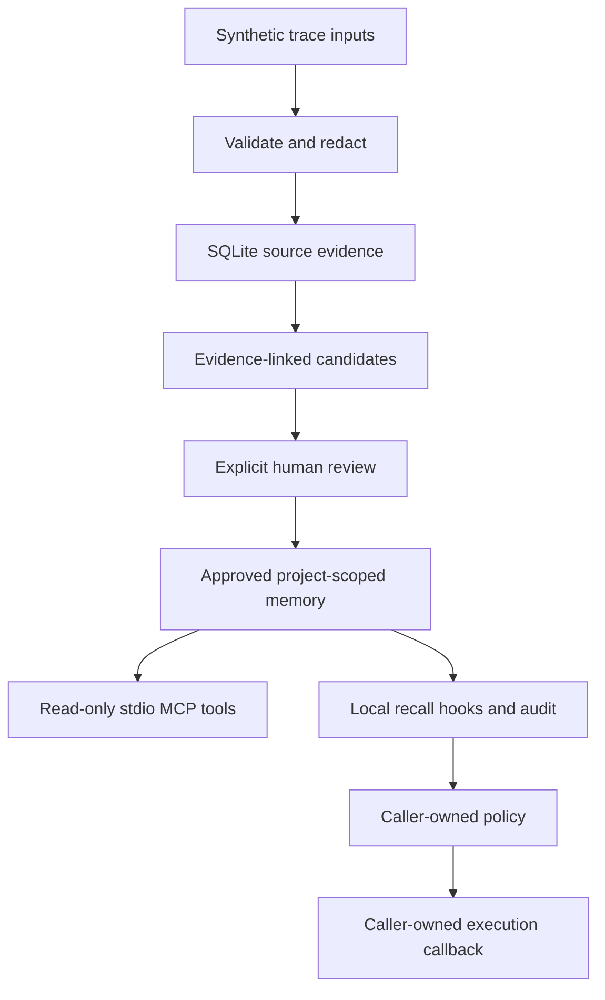

# Recall before actions: integration findings

The service now exposes approved, project-bound memory through stdio MCP and a local
recall loop. A disposable Python fixture demonstrates prerequisite ordering with a
scripted policy: one approved same-project pre-command case passes; the other eleven
cases fail. This establishes a working integration path and a constructed execution
example. It does not establish improved coding-agent performance.

## Evidence and reproducible demo

Run from the repository root with Python 3.11+ and uv:

```bash
uv sync --locked --extra dev
uv run python experiments/retrieval_baseline.py --check
uv run python experiments/review_quality.py --check
uv run python experiments/mcp_smoke.py --check
uv run python experiments/recall_loop.py --check
uv run python experiments/local_execution.py --check
```

Each check compares its result with the committed per-case JSON artifact and exits
nonzero on a mismatch. The disposable execution runner creates fresh directories and
SQLite state; no existing database or application setup is needed. Omit `--check` to
regenerate an artifact intentionally, then inspect its diff.

| Evidence type | Reproduced observation | What it supports |
| --- | --- | --- |
| Synthetic retrieval | [5/6 positive top-1; 2/2 abstentions](retrieval-baseline.json) | Lexical matching on a tiny development set, with a retained paraphrase miss |
| Review contracts | [6/6 checks](review-quality.json) | Explicit review and replacement boundaries; poison rejection is manual |
| Actual local MCP transport | [11/11 checks](mcp-smoke.json) | SDK initialization, tool calls, source inspection and project binding |
| Scripted callback replay | [6 cases](recall-loop.json), only approved same-project pre-command dispatches | Hook ordering, audit visibility and query sensitivity |
| Actual local command execution, scripted policy | [12 cases](local-execution.json), one pass and eleven failures | Fixed generator runs before a fixed check in the matching approved case |
| Live LLM behavior | Not measured | No instruction-following, task-success or token-saving claim |

These counts describe different contracts and must not be pooled into a success rate.
The linked artifacts retain individual outcomes and source hashes. Execution results
also record program hashes, command order, exit codes, stdout/stderr and recall audit.
All supplied traces are invented; no user sessions were imported. The existing
[dataset notes](../../examples/README.md) describe provenance and development-set limits.

## Why the execution outcomes differ

The task-start query, `Investigate a development task`, misses the generated-client
lesson. The pre-command context, `integration tests generated client`, shares its
vocabulary and retrieves it when approved for `storefront`. The policy recognizes that
fixture's memory ID and invokes a fixed generator before permitting the fixed check.
Disabled recall, proposed memory and a different project never trigger generation.
Their checks exit 1 with `generated client missing`; the matching approved pre-command
case records generation exit 0 and check exit 0 with `client ready`.

Retrieval changes the input to a policy whose response was explicitly programmed.
The policy does not understand arbitrary corrections. A better task-start query might
retrieve the lesson too; this experiment does not prove pre-command recall is generally
superior. The eleven failures are retained controls, not eleven independent real tasks.

## Architecture and trust boundaries



The loop calls the local Store API; the MCP transport is tested independently. This
is not an end-to-end MCP-host agent trial. A host must explicitly arrange recall
before actions. Review and revision occur outside the read-only transport. Project
binding limits retrieval scope but does not authenticate filesystem users.

Reviewed text remains untrusted evidence. Applicability is descriptive, not an enforced
execution policy. Neither extraction nor retrieval detects poisoned advice reliably.
The execution demo invokes repository-authored programs without a shell, never command
text from a trace or memory. Temporary directories are disposable fixtures, not an OS
security sandbox. Real applications must provide their own policy and isolation.

## Validation and open questions

The locked install, Ruff lint and formatting, and 89 tests pass. The five reproduction
commands above pass against unchanged result artifacts. No dependencies changed for
this report. No live model or paid service was called; credentials and a spending cap
for a live-model evaluation have not been established.

The retrieval set is small, curated and not held out. Semantic duplicate handling,
paraphrases, distractors, harmful retrieval and independent application tasks still
need broader evaluation. Freeze independent cases before tuning, then measure retrieval
and execution separately. Real native-session ingestion, comprehensive redaction and
a live host integration remain incomplete. There is no evidence yet of general agent
improvement or token savings.
